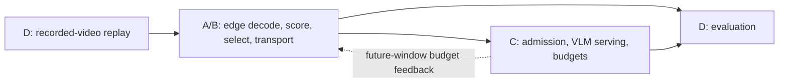

# Architecture and responsibilities

The first workload is traffic collision analysis. The task category is known at
selection time; recorded videos are replayed causally as simulated live cameras.

## Ownership and handoffs

- D supplies the source-video manifest, camera/window identity, replay schedule,
  and evaluation labels. Labels stay in evaluation, separate from inference inputs.
- B decodes and buffers arrived footage, invokes A's selection, and accounts for
  encoded bytes and transport timing. A owns cheap scoring and evidence selection.
- B hands evidence and window metadata to C. The media representation is unresolved:
  selected timestamped frames and short clips are alternatives for joint review.
- C owns admission and inference, and returns results, statuses, and serving timing.
  It may send a budget for a subsequent window back to B; feedback behavior is draft.
- D joins edge and central records by window identity and compares against baselines.

Only the shared metadata model exists in this scaffold. Component modules expose
no runtime pipeline API yet. RunPod is the initial GPU target from the meeting;
physical edge limits are simulated. Keep deployment/provider details outside contracts.

## Design decisions still needed

Agree on frames versus clips, the serving engine, workload window settings, transport,
result/status shape, feedback units and cadence, and retry/drop/deadline behavior.
Full-video archival is an experimental question, not a required storage subsystem.
No implementation should infer these decisions from the presence of example metadata.

## Research references

See the local [proposal snapshot](research/project-proposal.md) and
[initial dataset/pilot evaluation](research/dataset-selection-and-pilot.md).
The October 27 meeting narrowed the initial workload to collisions, chose simulated
edge constraints and RunPod, and assigned repo/interfaces to Aditya before A/B research.
