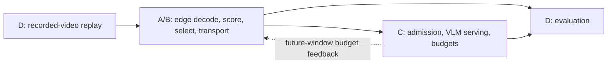

# Architecture and responsibilities

The first workload is traffic collision analysis. The task category is known at
selection time; recorded videos are replayed causally as simulated live cameras.

## Ownership and handoffs

- D supplies the source-video manifest, camera/window identity, replay schedule,
  and evaluation labels. Labels stay in evaluation, separate from inference inputs.
- B decodes and buffers arrived footage, invokes A's selection, and accounts for
  encoded bytes and transport timing. A owns cheap scoring and evidence selection.
- B hands evidence and window metadata to C. The media representation is unresolved:
  selected timestamped frames and short clips are alternatives for joint review.
- C owns admission and inference, and returns results, statuses, and serving timing.
  It may send a budget for a subsequent window back to B; feedback behavior is draft.
- D joins edge and central records by window identity and compares against baselines.

The shared contracts hold window metadata plus draft inference request, result, and
edge-record models proposed by A/B. Component modules expose no stable runtime API yet. RunPod is the initial GPU target from the meeting;
physical edge limits are simulated. Keep deployment/provider details outside contracts.

## Design decisions

The [decision log](decisions.md) records each decision and whether it is agreed or
only proposed. A/B have proposed JPEG frames sent to vLLM as separate images, a
request/result/edge-record shape, and defaults for windows, deadlines, and budgets;
these await C/D review. Full-video archival is an experimental question, not a
required storage subsystem. No implementation should treat a proposed decision as
agreed.

## Research references

See the local [proposal snapshot](research/project-proposal.md) and
[initial dataset/pilot evaluation](research/dataset-selection-and-pilot.md).
The October 27 meeting narrowed the initial workload to collisions, chose simulated
edge constraints and RunPod, and assigned repo/interfaces to Aditya before A/B research.
