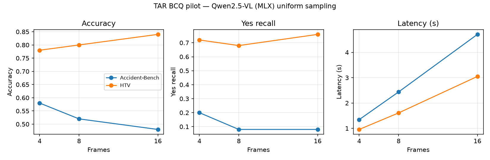

# Dataset Selection and Pilot Experiment

> **Initial dataset evaluation and pilot — snapshot imported November 3, 2026.**
> Source: [original dataset/pilot gist](https://gist.github.com/adityachandak287/1e37deccd4c62d375624f419238c8245).
> Dataset availability statements reflect the original evaluation and have not
> been rechecked. Pilot results are historical laptop measurements, not current
> server or edge performance. The plot is copied from the saved local pilot artifact.
> See [architecture](../architecture.md) and [contracts](../contracts.md) for current scope.

## Summary

We compared three candidate datasets for our project on frame selection and budgeting for shared VLM serving. **We recommend NVIDIA's Traffic Anomaly Reasoning dataset (TAR) as our primary dataset.** It is the only one of the three that we can download, score, and use for traffic-camera questions today.

We then ran a small experiment on TAR to test the assumption our proposal depends on: does giving the model more video frames change answer quality and cost? The result: **cost goes up steadily with more frames, but quality does not simply improve.** It depends on the type of question.

---

## Part 1: How we chose the dataset

Instead of going on intuition, we checked each dataset against three basic requirements:

1. **Can we actually get the videos?**
2. **Does it come with questions and correct answers we can score against?**
3. **Does it look like our setting: fixed city traffic cameras?**

| Dataset | Videos available? | Questions + answers? | Fixed traffic cameras? | Decision |
|---|---|---|---|---|
| **TAR** (NVIDIA) | Yes | Yes | Yes | **Use as primary** |
| **MetroSurv** | No | Yes | Yes | **Blocked** |
| **DeepAccident** | Yes | No | Mostly no (cameras on cars) | **Backup option only** |

### Why not MetroSurv?
The questions are a good fit for our project, but **the videos have not been released**. The question file points to 1,121 separate video files, and only 3 sample videos are available online. It appears to be an anonymous upload for a paper under review. We can revisit it if the authors release the videos.

### Why not DeepAccident?
It is a **simulated** driving dataset, built with the CARLA driving simulator. It has 3D labels for self-driving research, but **no questions or answers**, so we would have to write our own. Its cameras are mostly mounted on cars, not fixed city cameras.

It does have one advantage: because it is simulated, it records exactly when each collision happens. If TAR's labels turn out to be unreliable, we could generate our own questions from those exact timings. That makes it a reasonable backup.

### What TAR gives us
- About 3,700 traffic camera videos, drawn from 8 public video collections
- Several question types for each video: yes/no, multiple choice, "when did it happen," and others
- The yes/no questions come in pairs: **one Yes and one No per video**

### Limitations of TAR we should be upfront about
- **The labels we can use were written by AI** (Gemini and Gemma), not by people. The human-checked test answers are hidden and can only be scored by the challenge's official server.
- **The "No" questions are trick questions about details in the same video.** For example: "Does the truck flip *on camera*?" for a video where the truck has already flipped. They are not empty or quiet scenes, so we **should not** report "false alarm rates" from them.
- TAR doesn't give us repeated questions over a live camera stream. We will have to build that part ourselves.

---

## Part 2: What the data looks like

Each example is one video, one question, and a Yes/No answer.

**Example 1: highway traffic (HTV collection)**

| Field | Value |
|---|---|
| Video | `HTV/cctv052x2004080519x01683.mp4` |
| Question | "Do the vehicles on the highway maintain their lanes throughout the video?" |
| Correct answer | **Yes** |

Same video, second question:

| Field | Value |
|---|---|
| Question | "Is there any traffic congestion or slowing of vehicles observed on the highway?" |
| Correct answer | **No** |

**Example 2: crash video (Accident-Bench collection)**

| Field | Value |
|---|---|
| Video | `Accident-Bench/.../SrbylylFcsg_repeat.mp4` |
| Question | "Does the black sedan flip over after the collision?" |
| Correct answer | **Yes** |

Same video, second question:

| Field | Value |
|---|---|
| Question | "Is the road dry during the incident?" |
| Correct answer | **No** |

---

## Part 3: The mini experiment

### The question we were testing
Our proposal assumes there is a **tradeoff between frames and quality**: more frames cost more compute but give better answers. If that isn't true, there is nothing for our frame budgeting to optimize. So we tested it first.

### What we ran
| Setting | Value |
|---|---|
| Model | Qwen2.5-VL-7B (the model in our proposal), compressed version run on a laptop (Apple M5) |
| Data | **100 yes/no questions** from **50 videos** |
| Video types | 25 highway traffic videos (**HTV**) and 25 crash videos (**Accident-Bench**) |
| Answer balance | 50 Yes, 50 No |
| Frame counts tested | **4, 8, and 16 frames**, evenly spaced across each video |
| Total model calls | 100 questions × 3 frame counts = **300** |

We kept everything else fixed: same videos, same questions, same image size, same prompt. **Only the number of frames changed.**

### How we scored it
- **Accuracy:** the share of answers that were correct
- **Yes recall:** of the questions where the true answer is "Yes," the share the model got right. This matters because a model that always says "No" can still look decent on accuracy.
- **Latency:** how long each answer took

### Results

| Video type | Frames | Accuracy | Yes recall | Time per answer |
|---|---|---|---|---|
| Highway (HTV) | 4 | 78% | 72% | ~1.0 s |
| Highway (HTV) | 8 | 80% | 68% | ~1.6 s |
| Highway (HTV) | 16 | 84% | 76% | ~3.1 s |
| Crash (Accident-Bench) | 4 | 58% | 20% | ~1.3 s |
| Crash (Accident-Bench) | 8 | 52% | 8% | ~2.4 s |
| Crash (Accident-Bench) | 16 | 48% | 8% | ~4.7 s |

### What we found

1. **More frames always cost more time.** Response time grows roughly in proportion to the number of frames. That gives budgeting a real cost to trade off.
2. **On highway videos, more frames helped slightly.** Accuracy rose from 78% to 84%.
3. **On crash videos, more frames did not help.** Accuracy *dropped*, from 58% to 48%. The model answered **"No" about 90% of the time**, so it missed most real crashes.

A concrete example of point 3: for "Does the black sedan flip over after the collision?" (correct answer: Yes), the model answered **"No" at 4, 8, and 16 frames.** Adding frames only made it slower (about 1.9 s, then 2.8 s, then 5.7 s).

### What this means for our project
- **The cost side of the tradeoff is real:** every extra frame costs time.
- **The quality side depends on the kind of question.** Simply adding more evenly spaced frames is not enough, and for crash questions it can even hurt.
- This **supports the core idea of our proposal**: choosing *which* frames to use, and *how many* for each type of question, matters more than just using more frames.

### Caveats
- This is a **small pilot** (100 questions), meant to check direction, not to make final claims.
- It ran on a **laptop**, not our planned SGLang setup on a GPU server, so the response times show the trend, not real server speeds.
- The correct answers come from **AI-generated labels**.
- We sent frames as a series of images rather than through the model's built-in video input.

---

## Next steps
1. **Build "live camera" style questions** using TAR's event timestamps. Split each video into short windows and ask "Did an accident happen in this window?" This is closer to our monitoring use case, and it gives us real empty scenes to measure false alarms on.
2. **Try one smart frame selector** (for example, picking frames where motion or scene change happens) against even spacing, using the same number of frames.
3. **Move the setup to our GPU server** with SGLang once access is ready, and measure performance under shared load.
4. **Check MetroSurv again** in case the authors release the videos.
