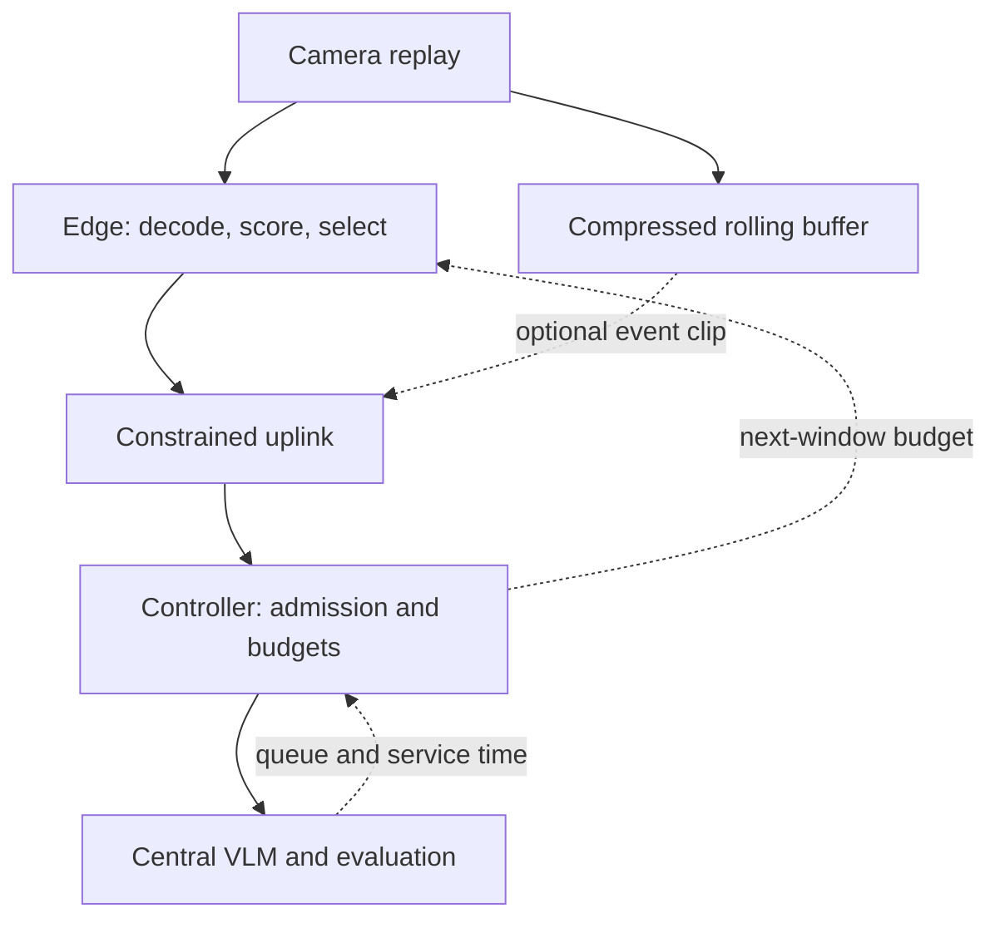

# Gigacity G1 — Edge Video Curation

> **Research snapshot — imported November 3, 2026.** Original October 2026
> proposal, preserved from `initial-research/Gigacity_G1_Project_Proposal.md`.
> Some open questions were subsequently resolved in the October 27 meeting.
> Use [architecture](../architecture.md) and [contracts](../contracts.md) for
> current implementation scope and interface status.

**Project proposal and work plan · October 2026**  
**Team:** Aditya, Aryan, Anishka and Parvi; Elaine’s participation to be confirmed. Workstreams are open for opt-in.  
**Target:** review/demo December 11; handoff December 12, one week before December 19.

## 1. Research problem

**How can a constrained edge device preserve useful evidence from multiple cameras without sending every frame to a central VLM?**

We propose **streaming selection at the edge, with central VLM inference**. The decisions are **which frames, how many, and when to transmit/process them**. This follows the mentors’ interest in key-frame selection, data curation and network constraints. Full-video upload is a comparison baseline; team/mentor endorsement is pending.

Three questions guide the work:

- **Selection:** Can cheap motion/object cues preserve brief events better than uniform sampling at the same budget?
- **Budgeting:** Does adapting to bandwidth and central serving load improve quality delivered on time?
- **Retention:** How does the answer change when the eventual question is unknown during selection?

Edge filtering already has prior work, including Reducto. Our proposed contribution is to measure and improve the interaction between evidence quality and system constraints; novelty is not yet established.

## 2. Decisions for team and advisor review

| Decision | Open question | Proposed starting point |
|---|---|---|
| **Primary workload** | Answer known questions live, or preserve evidence for questions asked later? | Explore both on one pipeline; choose the primary evaluation by **Nov 9**. |
| **Success criterion** | Is the priority timely alerts or retained QA quality? What delay/quality loss is acceptable? | Live: correct answers before a deadline plus false alarms. Later queries: QA quality versus retained bytes. Targets remain open. |
| **Footage retention** | Can unselected footage expire, or must full video remain available for review? | **60-second compressed edge buffer**; later questions use selected evidence after expiry. Full archival changes the storage-saving claim. |
| **Compute** | Is physical edge hardware available, and what GPU allocation can we use? | Jetson-class reference; **one Seneca GPU**, RunPod fallback; **40 GPU-hours** initially. |
| **Ownership** | Who opts into A–D, coordinates integration, and confirms Elaine’s participation? | Four component owners; optional fifth person supports model comparisons and reproducibility. |

**Workload distinction:** live monitoring can use a preconfigured query during selection. Later-query curation must withhold the question until selection is complete. Both selectors see only frames that have arrived. Teams can explore the two modes using shared components; a later-query experiment can use known clip IDs without building a search engine.

## 3. Proposed architecture

Start with uniform and motion/change selection at fixed budgets. Add a detector/tracker if it improves evidence quality. Then test budget feedback, preserving minimum coverage across cameras. Motion or object detections alone do not establish an anomaly.

**Shared interface:** camera/window ID, ordered frames with capture timestamps, encoded bytes, optional query/deadline; feedback specifies the next window’s budget. Log drops and time spent in selection, transmission, queueing and inference. Optional clip uploads count toward bandwidth.

Selection trades network and GPU savings against the risk of losing useful evidence. Adaptive feedback will be evaluated against fixed-budget selection.

## 4. Hardware assumptions and resource estimates

**All allocations and workload settings below are proposed assumptions, not measurements.** Seneca’s A100 40 GB and H100 80 GB options are documented; project access/allocation still needs confirmation. No physical edge device is confirmed.

| Role | Starting assumption | What it enables |
|---|---|---|
| **Edge** | Orin Nano Super: **8 GB shared RAM**, up to 67 sparse INT8 TOPS; reserve 3 GB for OS/runtime/buffers | Start with **4 cameras**, stress 8/12; lightweight selection first. |
| **Central** | **1× A100 40 GB**, 16 CPU cores, 64 GB host RAM | One SGLang VLM replica; measure concurrency before adding GPUs. |
| **Fallback/headroom** | Seneca **H100 80 GB** or a comparable RunPod instance | More memory/throughput if justified; report GPU configurations separately. |

### Plausible model choices

| Candidate | Approximate weights | Role |
|---|---:|---|
| Frame difference / motion statistics | No large model | Cheapest edge baseline |
| **YOLO11n + tracking** | **5.2 MB FP16**; 6.5 GFLOPs per 640×640 input | Edge object/motion cues |
| **SmolVLM2-500M** | **1 GB at 16-bit** | Optional sparse edge semantic scoring |
| **Qwen2.5-VL-3B / 7B** | Published checkpoints: **7.51 / 16.58 GB** | Central quality/cost comparison; **7B BF16** proposed baseline |

Weight fit is only a first check: add vision activations, KV cache and runtime memory. A fully 4-bit 3B checkpoint would ideally be ≈1.88 GB, but partial quantization and overhead increase this. Text-only LLMs require structured visual features; they cannot inspect raw frames.

**Estimated resource demands** — decimal GB/MB throughout:

| Constraint | Assumptions and calculation | Implication |
|---|---|---|
| **Edge compute** | 8 cameras × 2 detector evaluations/s × 6.5 GFLOPs = **104 GFLOP/s**, excluding decode/preprocessing | Benchmark the complete pipeline. Sparse INT8 TOPS cannot predict FP16 throughput. |
| **Central memory** | 16 frames/request, ≈256 visual tokens/frame + 320 text/output tokens; 7B BF16 KV ≈0.253 GB/request. **16.58 GB weights + 16×0.253 GB KV + 10 GB runtime reserve ≈30.6 GB** | A **40 GB GPU is plausible**, subject to processor behavior and peak-memory checks. |
| **Uplink** | 8 cameras × 8 JPEGs/10 s × 100 kB × 8 = **5.12 Mbit/s**, versus **16 Mbit/s** at 2 Mbit/s full video/camera | Already exceeds a **5 Mbit/s link** before overhead. Smaller budgets or more capacity are necessary. |

For the memory estimate, images fit within 448×448; the 7B configuration gives **57,344 KV bytes/token**. The 10 GB reserve and 16 resident requests are planning assumptions, not measured capacity.

**Storage/latency:** eight 2 Mbit/s cameras generate **172.8 GB/day**; a 60-second compressed buffer needs **120 MB**. One request/camera/10 seconds gives **0.8 requests/s**; with 30% headroom, target measured capacity ≥**1.14 requests/s**. Proposed live timing is 10-second windows with answers within 5 seconds of window close; this target is subject to agreement on the workload.

**Resource request:** 40 GPU-hours initially; provisional total **250 hours** (40 pilot + 160 evaluation/integration + 50 contingency), revised after profiling. Cost is hours × actual provider rate, plus storage/transfer. Propose 250 GB project storage. Emulate the external uplink: Seneca’s internal network is not the camera link. Server emulation cannot validate Jetson power/throughput.

## 5. Preliminary evidence and evaluation

**Pilot takeaway:** on 50 videos/100 questions, moving from 4→16 uniform frames improved HTV accuracy **78→84%**, but reduced Accident-Bench **58→48%**. More frames were slower and not reliably better. This pilot used 4-bit Qwen2.5-VL-7B/MLX on Apple M5; they are exploratory whole-clip QA, not edge or serving measurements.

| Compare | Measure |
|---|---|
| Uniform vs content selection, equal budgets | Event capture and downstream QA quality |
| Fixed vs network-aware vs server-aware vs combined budgets | Correct on-time answers, bytes and total latency |
| Full-video upload vs edge selection, same causal windows/model/input cap | End-to-end resource savings |
| Known-query vs withheld-query selection | Evidence quality versus retained bytes/query delay |

Use TAR temporal annotations and binary QA; audit a held-out subset and split by source video. **A selected frame inside an event is not proof of sufficient evidence.** Whole-clip labels cannot automatically score earlier live windows. Check effective frames/timestamps through SGLang, include preprocessing/transmission in latency, and repeat load tests. JPEGs may exceed efficient compressed video in size; measure actual bytes.

Model quality with adequate evidence will be checked before attributing failures to selection or scheduling.

## 6. Proposed workstreams

| Stream | Research question and concrete work | Deliverable |
|---|---|---|
| **A · Selection** | Which cheap cues preserve evidence? Uniform, motion/coverage, detector-assisted selection | Selector interface and quality/cost curves |
| **B · Edge + transport** | What can one node sustain? Decode/encode, buffering, link limits, retention | Reproducible edge/network harness and resource measurements |
| **C · Serving + budgets** | When does feedback help? Model setup, profiling, queue telemetry, fixed/adaptive budgets | Serving endpoint and controller comparisons |
| **D · Workload + evaluation** | What counts as success? TAR audit, causal replay, query timing, load sweeps | Shared test manifest, metrics and comparison report |

**Four people:** one owner per stream; A+B form the edge pair, C+D the central/evaluation pair. D supplies replay/labels, A/B supply frames and telemetry, C returns answers/timing. **Fifth person, if available:** model/precision comparisons and reproducibility. Integration remains a shared responsibility with one named coordinator.

## 7. Milestones and scope decisions

| Dates | Reviewable outcome |
|---|---|
| **Oct 27–Nov 2** | Owners/interfaces agreed; shared repo; audited subset; uniform end-to-end baseline; compute confirmed |
| **Nov 3–9** | Selection, bandwidth and serving curves; choose primary workload and model; decide whether feedback is worth pursuing |
| **Nov 10–16** | Content selector, constrained uplink and serving integrated; fixed-budget baseline reproducible |
| **Nov 17–23** | First adaptive policy; concurrent-camera tests; isolate selection versus budgeting benefits |
| **Nov 24–30** | Holiday allowance: robustness and label checks; optional retention/later-query extension |
| **Dec 1–7** | Final comparisons, repeated runs, report/demo draft; freeze features |
| **Dec 8–12** | Reproduction check and final handoff; review/demo by **Dec 11** |

**Nov 9 decision:** if feedback adds little, focus on selection/retention; if selection adds little, investigate budgeting. If the VLM fails with good evidence, revisit model/task first. Physical edge deployment, new-model training and internal SGLang scheduler changes are optional extensions.

### Source notes

Based on the October 20 team meeting, Aditya’s saved pilot results and Cornell CAC’s Seneca specifications. Allocations, policies and milestones are proposals for review. Technical references checked October 27, 2026:

- [Seneca](https://portal.cac.cornell.edu/techdocs/clusters/seneca/) · [Orin Nano Super](https://www.nvidia.com/en-us/autonomous-machines/embedded-systems/jetson-orin/nano-super-developer-kit/) · [YOLO11](https://docs.ultralytics.com/models/yolo11/)
- [SmolVLM2](https://huggingface.co/HuggingFaceTB/SmolVLM2-500M-Video-Instruct) · Qwen checkpoint sizes: [3B](https://huggingface.co/Qwen/Qwen2.5-VL-3B-Instruct/blob/main/model.safetensors.index.json), [7B](https://huggingface.co/Qwen/Qwen2.5-VL-7B-Instruct/blob/main/model.safetensors.index.json) · [7B KV/vision configuration](https://huggingface.co/Qwen/Qwen2.5-VL-7B-Instruct/blob/main/config.json)
- [SGLang multimodal support](https://github.com/sgl-project/sglang/blob/main/docs/docs/supported-models/multimodal_language_models.mdx) · [TAR](https://huggingface.co/datasets/nvidia/PhysicalAI-Traffic-Anomaly-Reasoning) · [Reducto](https://www.cs.princeton.edu/~ravian/publications/reducto_sigcomm20.pdf)
